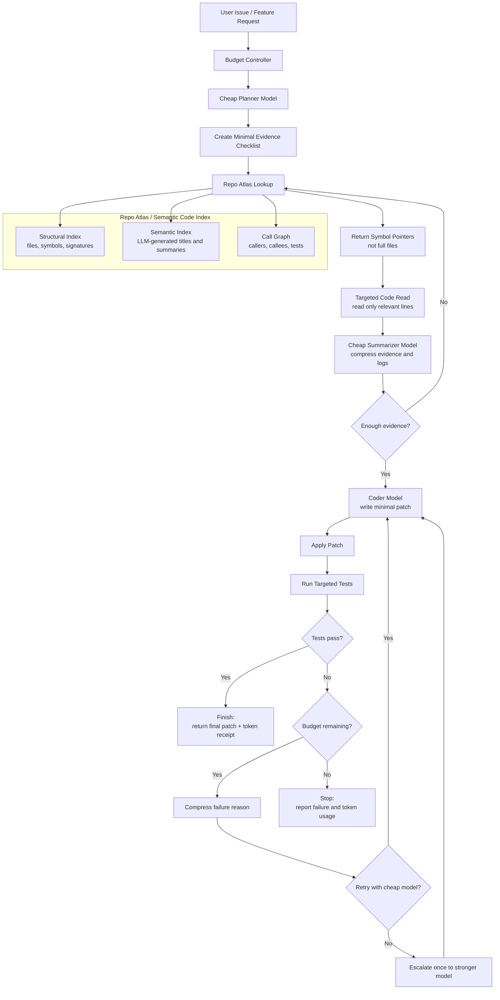
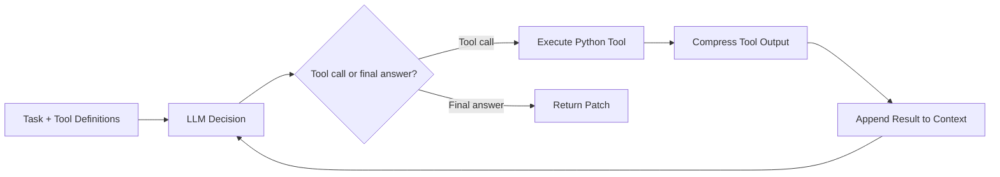
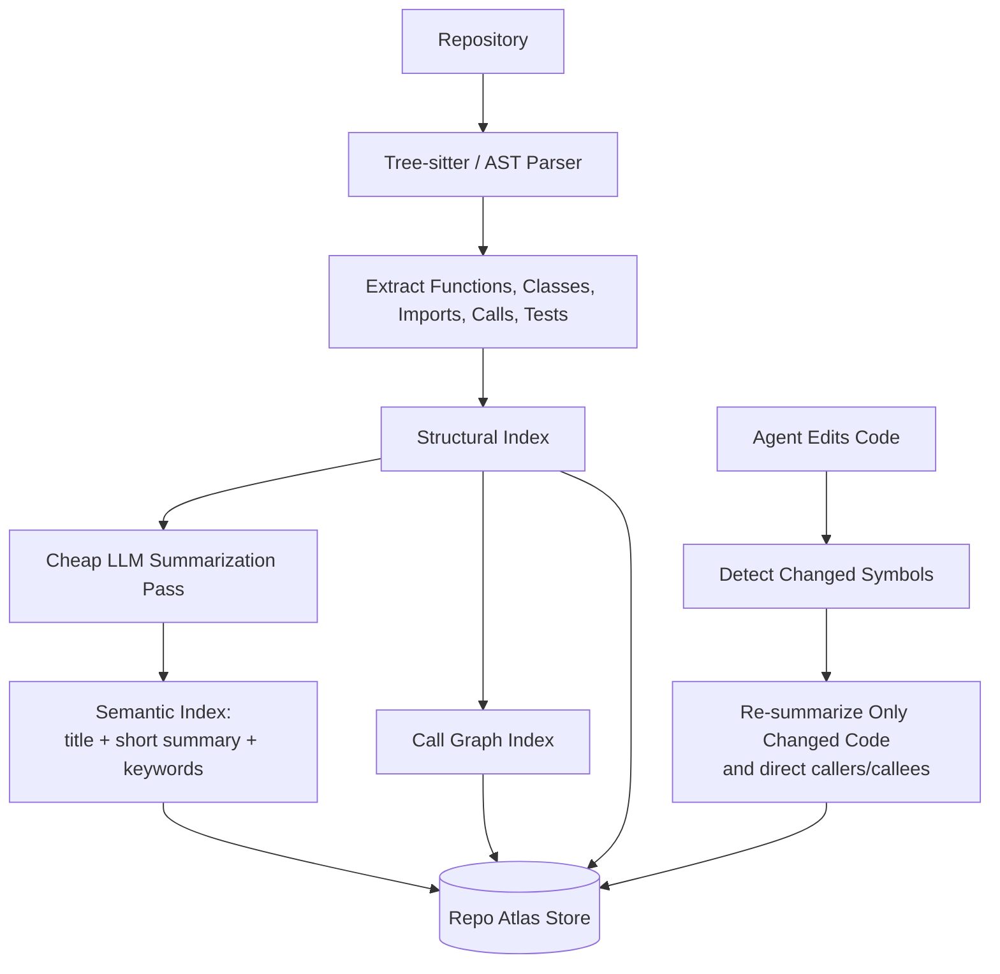
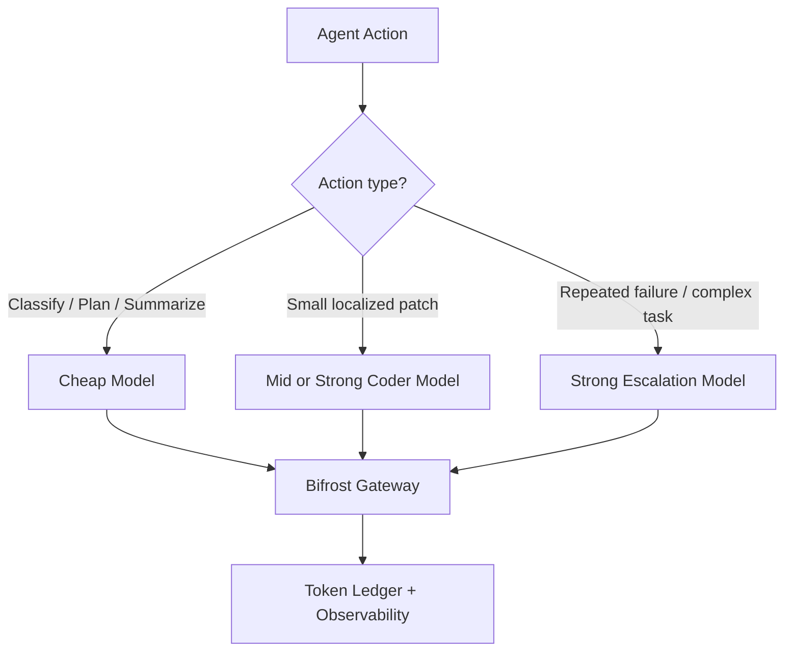
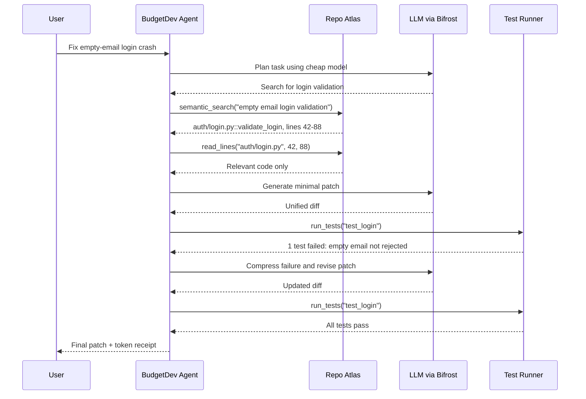

# BudgetDev — Token-Efficient Coding Agent

BudgetDev is a coding agent designed to complete software tasks using the **fewest tokens possible without sacrificing correctness**.

Instead of letting the LLM browse an entire repository, it first builds a one-time **semantic code index** (the *Repo Atlas*), then retrieves only the smallest relevant code windows needed to solve the task.

## Core Idea

> **Pay once to understand the repository. Retrieve by meaning. Read only what matters. Spend tokens only where they improve the chance of a correct, test-passing patch.**

## High-Level Process



## Agent Loop

The agent is a simple **Reason → Act → Observe** loop.



The LLM decides **what to do**. Your Python code performs the actual work: searching the index, reading code, applying patches, and running tests.

## Tools

| Tool | Purpose | Token-Saving Role |
|---|---|---|
| `semantic_search` | Find functions/classes by meaning | Avoids broad grep and file exploration |
| `find_symbol` | Locate an exact function or class | Returns a precise pointer |
| `get_call_graph` | Show callers, callees, and related tests | Avoids reading unrelated modules |
| `read_lines` | Read a specific line window | Prevents whole-file reads |
| `write_patch` | Apply a unified diff | Avoids rewriting entire files |
| `run_tests` | Run selected tests | Avoids huge full-test logs |
| `finish` | Submit the final patch | Ends the loop |

## Repo Atlas

The Repo Atlas is built once, then updated incrementally after edits.



Example index entry:

```json
{
  "id": "auth/login.py::validate_login",
  "title": "Validate user login credentials",
  "summary": "Checks email and password, rejects empty email, returns a session or AuthError.",
  "keywords": ["login", "authentication", "email validation"],
  "file": "auth/login.py",
  "lines": "42-88",
  "calls": ["db.get_user", "security.hash_password"],
  "called_by": ["api/routes/auth.py::login_handler"],
  "tests": ["tests/test_login.py::test_empty_email_rejected"]
}
```

## Model Routing

BudgetDev uses Bifrost to route work to the cheapest model that can handle it.



Bifrost provides a single gateway for multiple providers, virtual keys, budgets, rate limits, routing, caching, and observability.

## Token Budget Policy

Before each action, the Budget Controller asks:

1. Can the Repo Atlas answer this without an LLM?
2. Can a cheap model handle it?
3. Do we need to read more code?
4. Should we run only targeted tests?
5. Should we escalate to a stronger model?
6. Should we stop because the budget is exhausted?

The agent optimizes:

\[
	ext{Token Efficiency} = rac{	ext{Tasks successfully resolved}}{	ext{Total tokens used}}
\]

## Example Flow

**Issue:** “Login crashes when email is empty.”



## Evaluation

Compare these configurations on the same tasks:

| Configuration | Purpose |
|---|---|
| Baseline agent | Shows normal token consumption |
| Baseline + Repo Atlas | Measures retrieval savings |
| Baseline + Repo Atlas + Budget Controller | Measures full-system savings |

Track:

- Total input and output tokens
- Number of LLM calls
- Number of files read
- Number of tests run
- Patch correctness / tests passed
- Cost and wall time
- Tokens per successfully resolved task

## Demo Message

> BudgetDev plans before it reads, retrieves only the code it needs through a semantic Repo Atlas, compresses everything it observes, and routes work through Bifrost so tokens are spent only where they change the outcome.
