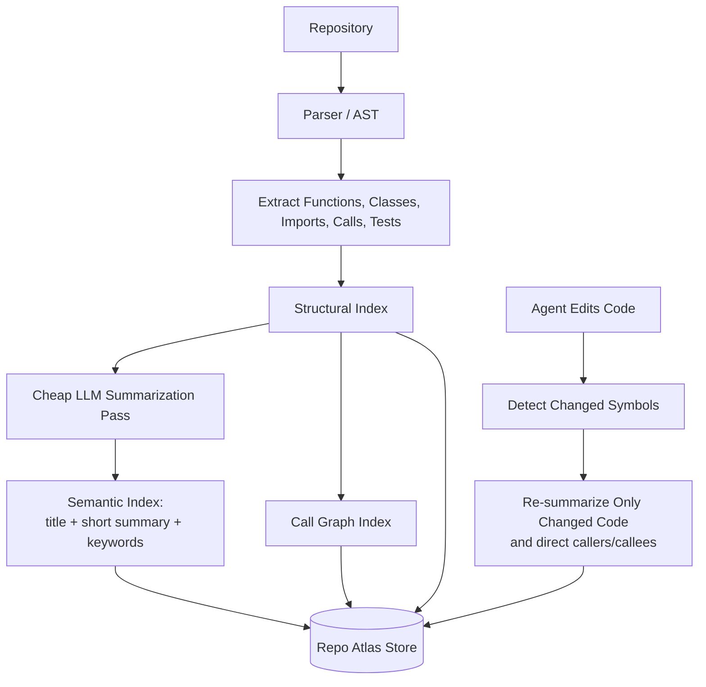
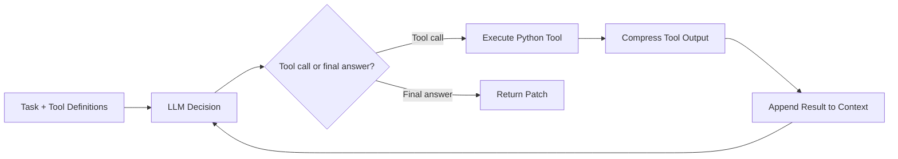
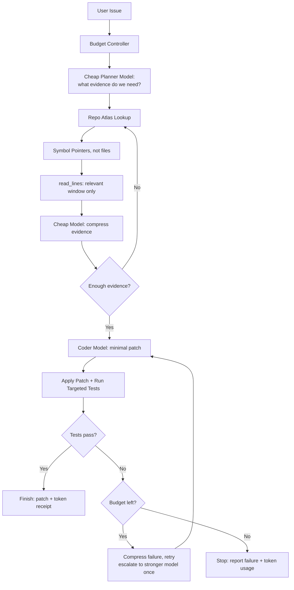
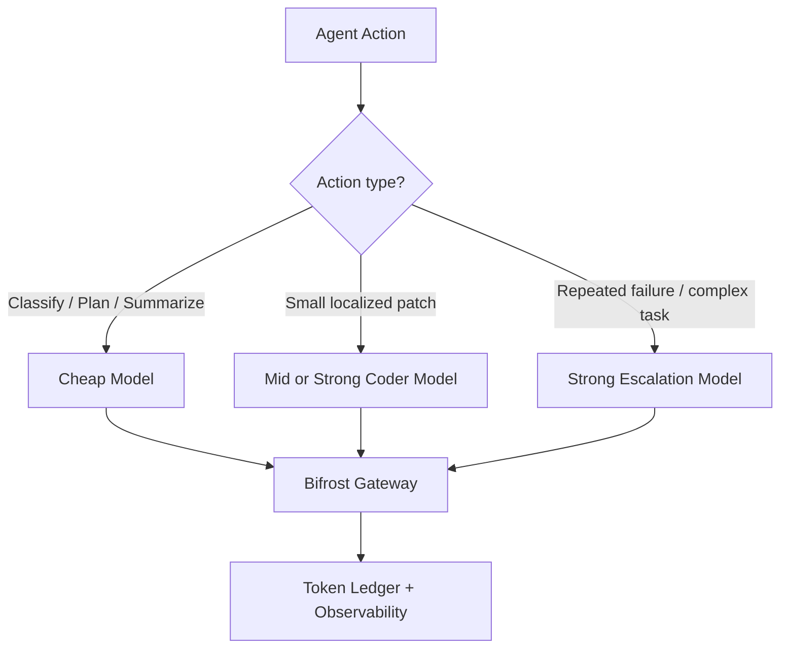
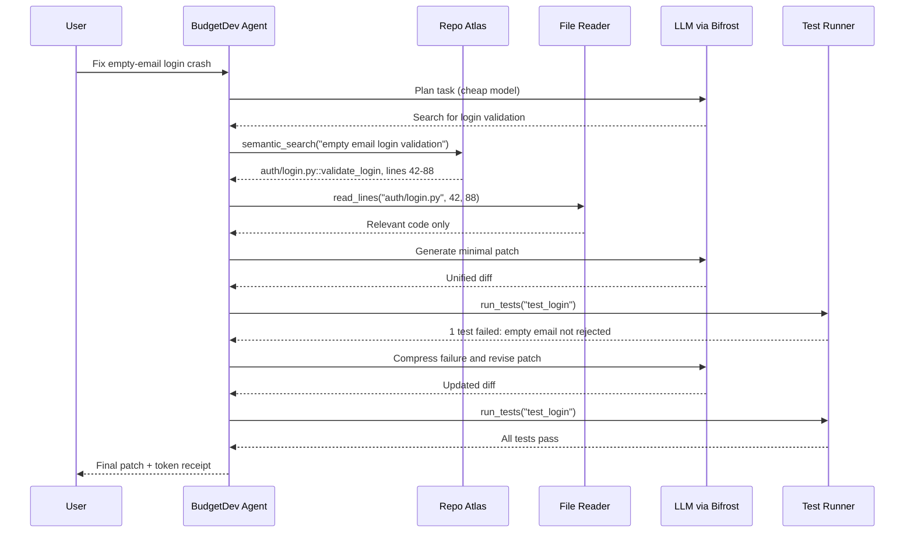

# BudgetDev — Token-Efficient Coding Agent

BudgetDev is a coding agent that fixes software issues using the **fewest tokens possible without sacrificing correctness**. It builds a one-time semantic index of a repository (the *Repo Atlas*), then retrieves only the small code windows a task needs, instead of letting the LLM browse the repo.

> **Pay once to understand the repository. Retrieve by meaning. Read only what matters. Spend tokens only where they improve the chance of a correct, test-passing patch.**

## The Problem

Coding agents are expensive, and most of the cost is waste, not reasoning:

- They **explore blindly**: grep, open whole files, repeat.
- They **re-read the same context** on every turn of the loop.
- They **paste raw tool output** (full file dumps, huge test logs) back into the prompt.
- They **use one expensive model for everything**, including trivial steps like summarizing a log.

The result is high cost and latency per task, and budgets that are hard to predict or cap.

## The Solution

BudgetDev attacks each source of waste:

| Waste | BudgetDev's answer |
|---|---|
| Blind exploration | **Repo Atlas**: search code by meaning and get symbol pointers, not files |
| Whole-file reads | **`read_lines`**: read only the relevant line window |
| Raw tool output in context | **Compress** every observation before it enters the context |
| One model for everything | **Model routing**: cheap model for planning/summarizing, stronger model only when needed |
| Unbounded spend | **Budget Controller** with a hard token cap and a token receipt |

## Status: What Works Today

This is a proof of concept. The core loop works end to end; the rest of the design is planned.

| Component | Status | Notes |
|---|---|---|
| Agent loop (Reason → Act → Observe) | ✅ / 🔜 | TODO: confirm |
| Repo Atlas: structural index | ✅ / 🔜 | TODO: AST parser or simpler approach? |
| Repo Atlas: semantic summaries | ✅ / 🔜 | TODO |
| Call graph (callers, callees, tests) | 🔜 | TODO |
| Incremental index update after edits | 🔜 | TODO |
| Tools: `semantic_search`, `read_lines`, `write_patch`, `run_tests`, `finish` | ✅ / 🔜 | TODO: list which exist |
| Tools: `find_symbol`, `get_call_graph` | 🔜 | TODO |
| Output compression | ✅ / 🔜 | TODO |
| Model routing via Bifrost | ✅ / 🔜 | TODO |
| Token budget + receipt | ✅ / 🔜 | TODO |

## Quickstart

```bash
git clone https://github.com/YazanDash/global-hackathon
cd global-hackathon
pip install -e .
cp .env.example .env        # add your API keys
# TODO: exact commands
# python -m budgetdev index <path-to-repo>
# python -m budgetdev fix <path-to-repo> "Login crashes when email is empty"
```

## How It Works

### 1. Index once (Repo Atlas)

The repository is parsed into functions, classes, imports, calls and tests. A cheap model writes a short title, summary and keywords for each symbol. Only changed symbols (and their direct callers/callees) are re-summarized after edits.



Example index entry:

```json
{
  "id": "auth/login.py::validate_login",
  "title": "Validate user login credentials",
  "summary": "Checks email and password, rejects empty email, returns a session or AuthError.",
  "keywords": ["login", "authentication", "email validation"],
  "file": "auth/login.py",
  "lines": "42-88",
  "calls": ["db.get_user", "security.hash_password"],
  "called_by": ["api/routes/auth.py::login_handler"],
  "tests": ["tests/test_login.py::test_empty_email_rejected"]
}
```

### 2. Solve with a budgeted agent loop

The agent is a **Reason → Act → Observe** loop. The LLM decides *what* to do; Python code does the work (searching the index, reading code, applying patches, running tests). Every tool output is compressed before it is appended to the context.



### 3. Control the spend

Around the loop, a Budget Controller decides which model handles each step and when to stop. This is the target pipeline:



Before each action the controller asks: *Can the Atlas answer this without an LLM? Can a cheap model handle it? Do we need to read more? Should we run only targeted tests? Should we escalate? Is the budget exhausted?*

## Tools

| Tool | Purpose | Token-saving role |
|---|---|---|
| `semantic_search` | Find functions/classes by meaning | Replaces broad grep and file exploration |
| `find_symbol` | Locate an exact function or class | Returns a precise pointer |
| `get_call_graph` | Show callers, callees and related tests | Avoids reading unrelated modules |
| `read_lines` | Read a specific line window | Prevents whole-file reads |
| `write_patch` | Apply a unified diff | Avoids rewriting entire files |
| `run_tests` | Run selected tests | Avoids huge full-test logs |
| `finish` | Submit the final patch | Ends the loop |

## Model Routing

[Bifrost](https://github.com/maximhq/bifrost) is the single gateway for all model calls. It provides provider routing, virtual keys, budgets, rate limits, caching and a token ledger.



## Example Run

**Issue:** "Login crashes when email is empty."



## Evaluation

We compare three configurations on the same tasks:

| Configuration | Purpose |
|---|---|
| Baseline agent | Normal token consumption |
| Baseline + Repo Atlas | Retrieval savings |
| Baseline + Repo Atlas + Budget Controller | Full-system savings |

Metric:

$$
\text{Tokens per resolved task} = \frac{\text{Total tokens used}}{\text{Tasks successfully resolved}}
$$

We also track input/output tokens, LLM calls, files read, tests run, pass rate, cost and wall time.

### Results

| Configuration | Tasks | Resolved | Total tokens | Tokens / resolved task | LLM calls |
|---|---|---|---|---|---|
| Baseline | TODO | TODO | TODO | TODO | TODO |
| + Repo Atlas | TODO | TODO | TODO | TODO | TODO |
| + Atlas + Budget Controller | TODO | TODO | TODO | TODO | TODO |

*Even a small run (3–5 tasks on one repo) is enough for a POC. Report the one-time indexing cost separately.*

## Limitations and Next Steps

- **Indexing has an upfront cost.** It pays off only across multiple tasks on the same repo.
- **Summaries can be wrong or stale.** A bad summary can hide the right function. Incremental re-indexing and a fallback to plain text search are needed.
- **Static call graphs miss dynamic behavior** (dynamic dispatch, reflection, runtime registration).
- **Tests are required.** Without tests, the agent has no signal for "correct".
- Next: full call graph, incremental updates, multi-language support, larger